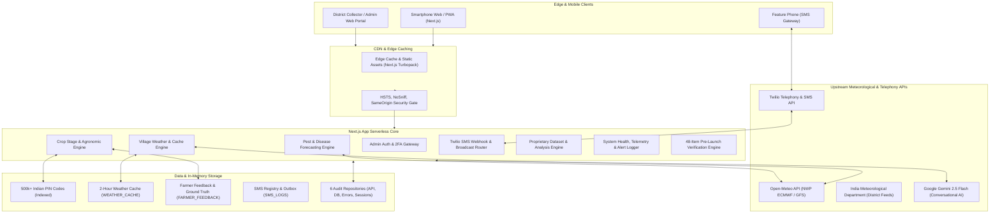

# GaganDrishti: Technical Architecture & System Design

## 1. System Topology Overview

---

## 2. Core Subsystems

### A. Hyperlocal Weather & 2-Hour Caching Engine
- **Endpoint**: `/api/village-weather` and `/api/weather/cache`
- **Mechanism**:
  1. Incoming requests check the `WEATHER_CACHE` table indexed by 6-digit postal code.
  2. If fresh (`cached_at + 2 hours > NOW()`), returns sub-10ms response immediately (`is_cached: true`).
  3. If expired or missing, triggers a resilient 5-second fetch to Open-Meteo, computes 12h curves and 7d forecasts, and stores in cache.
  4. If upstream API fails, automatically falls back to last-known stale cache with user warnings.
  5. An automated 3 AM maintenance job cleans expired records.

### B. Crop-Stage Decision Engine
- **Modules**: `cropStageDecisionEngine.ts` and `farmerDecisionEngine.ts`
- **Agronomic Logic**:
  - Models 10 crops (Soybean, Wheat, Mustard, Paddy, Cotton, Maize, Gram, Sugarcane, Potato, Tomato) across distinct phenological stages.
  - Computes Accumulated Growing Degree Days ($GDD = \frac{T_{\max} + T_{\min}}{2} - T_{\text{base}}$).
  - Determines Spraying Feasibility Window (wind speed $< 15\text{ km/h}$, rain probability $< 30\%$, temperature $< 35^\circ\text{C}$).
  - Evaluates Soil Moisture & Irrigation urgency based on 72h precipitation deficit.

### C. Pest & Disease Forecast Engine
- **Module**: `pestForecastEngine.ts`
- **Epidemiological Logic**:
  - Matches 45-day rolling meteorological averages against vulnerable crop stages.
  - Predicts risks for Fall Armyworm, Aphids, Whitefly, Rust, Blast, and Pod Borer.
  - Flags High/Medium/Low outbreaks with biological intervention advice (Neem oil, Trichoderma, pheromone traps).

### D. Security & Data Governance
- **Module**: `securityService.ts`
- **Protection**:
  - Server-side regex pattern detection for SQL injection and XSS threats.
  - Sliding-window in-memory rate limiting (max 20 req/min).
  - Strict PII masking on phone numbers, emails, and names.
  - DPDPA 2023 compliant data governance with published privacy policy.

### E. Telemetry & Administrative Monitoring
- **Module**: `monitoringEngine.ts`
- **Features**:
  - 6 persistent audit log tables: `API_CALL_LOGS`, `FORM_SUBMISSION_LOGS`, `SMS_LOGS`, `ERROR_LOGS`, `PERFORMANCE_LOGS`, `USER_SESSION_LOGS`.
  - 5 real-time threshold alert rules.
  - Daily 7:00 AM automated email health digest.
  - Pre-launch verification engine evaluating 48 parameters across 9 functional categories.
